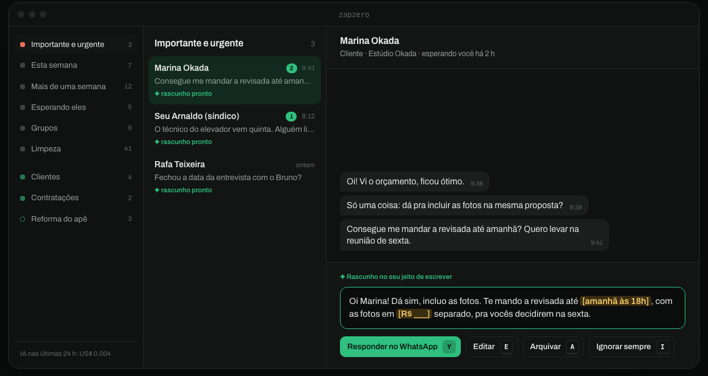

# zapzero

**Inbox zero for WhatsApp.** No bot, no ban risk, your chats never leave your Mac.

zapzero reads the WhatsApp Desktop app's own database on your Mac, **read-only**. AI triages every chat (who is waiting on whom, how urgent, who this person is to you) and drafts a reply in your own tone of voice for everyone waiting on you. You clear it from the keyboard: **Y** opens the chat in WhatsApp with the reply typed in, you press Enter. Next.



<sub>Names and messages are made up.</sub>

## Why it is safe for your number

- **Read-only.** zapzero copies the database the official app already keeps on disk (`sqlite3 mode=ro` + `.backup`) and works on the copy. It never writes to WhatsApp's files.
- **No bot, no linked device, no unofficial API.** Nothing talks to WhatsApp's servers. To WhatsApp, it's just you using the app.
- **Nothing is sent by zapzero.** A reply is typed into WhatsApp Desktop; you press Enter. Commitments (dates, prices, yes/no) are left `[in brackets]` for you to fill, and **Y** selects a bracket instead of sending.
- **No zapzero cloud.** Snapshots and state live in `~/Library/Application Support/zap` (chmod 700). Only the excerpt of each conversation goes to the model you choose, with your own key.

## What you get

- **Categories by when:** Important & urgent · This week · Older than a week · You're waiting on them · Groups · Cleanup.
- **Areas by who:** Clients, Hiring, Team, Investors, Partners, Family, Friends, Home & services, Selling to you, Other. Once a day the AI suggests new areas from your pending chats ("Apartment renovation", "Events & talks"); accept one and it becomes a triage choice.
- **Your tone of voice.** After the first scan the AI reads ~150 of your own messages and writes who you are and how you write. You accept or edit it on the **Seu jeito** screen; every draft follows it.
- **Keyboard flow:** `Y` reply · `E` edit · `R` new draft · `D` resolved · `A` archive · `S` skip · `I` ignore this person forever · `J`/`K` move · `Z` undo · `⌘↵` reply from the editor.
- **Runs in the background**, re-reading WhatsApp every 15 minutes and only re-doing AI work for chats that changed.

The UI is in Portuguese for now.

## Requirements

- macOS with [WhatsApp Desktop](https://www.whatsapp.com/download) linked to your phone. Linking syncs about the last 3 months of messages; older chats show in the list without text.
- [Bun](https://bun.com) 1.3+.
- An [OpenRouter](https://openrouter.ai/keys) key. Triage uses OpenRouter's decisions API with the Jev model (`typesafe/jev-1.14`, about US$0.00005 per chat); drafts and suggestions use a small chat model (`anthropic/claude-haiku-5.5` by default). Real numbers from one account: US$0.09 to triage 1,600 chats and draft 110 replies.

## Install

```sh
git clone https://github.com/vibegui/zapzero && cd zapzero
bun install
cp .env.example .env        # paste your OpenRouter key
bun run setup
```

`setup` checks everything, takes the first snapshot, builds the panel, installs a launchd agent (`dev.zapzero.server`) so the server starts at login, and prints the panel URL with your access token.

macOS blocks other apps' data until you allow it. If setup says it can't read WhatsApp's database: **System Settings → Privacy & Security → Full Disk Access**, add your terminal and the `bun` binary setup prints, then run it again.

## Use

Open `http://127.0.0.1:8810/?t=<token>` (the token is in `$ZAP_DATA/token`). Then:

1. Check **Seu jeito** in the sidebar: accept or edit who you are and how you write.
2. Start at **Importante e urgente**: `Y`, `Y`, `Y`, `E`, `Y`.
3. Press `I` on people you never want to see again.

From your phone or another computer, put it on your private [Tailscale](https://tailscale.com) network (never Funnel):

```sh
tailscale serve --bg --set-path=/zap http://127.0.0.1:8810
```

It also runs as an [MCP App](https://github.com/modelcontextprotocol/ext-apps) screen inside hosts like deco Studio: a tiny resource whose iframe points at your tailnet URL, granted with `_meta.ui.csp.frameDomains`. Chrome's Local Network Access blocks tailnet addresses inside other sites' iframes unless the host delegates `local-network-access`.

### Commands

```sh
bun run zap refresh     # snapshot -> triage -> drafts, once
bun run zap inbox       # counts per category
bun run zap voice       # re-read how you write
bun run zap suggest     # suggest new areas now
bun run start           # build + serve in the foreground (instead of launchd)
launchctl kickstart -k gui/$(id -u)/dev.zapzero.server   # restart the agent after updating
```

Settings live in `.env` (see `.env.example`): models, port, refresh interval, data dir.

### Uninstall

```sh
launchctl bootout gui/$(id -u)/dev.zapzero.server
rm ~/Library/LaunchAgents/dev.zapzero.server.plist
rm -r ~/Library/Application\ Support/zap    # your snapshots, drafts and decisions
```

## How it works

```
WhatsApp Desktop's SQLite ──read-only copy──▶ snapshot (every 15 min)
                                                   │
             Jev: wait / urgency / who / area ◀────┤  only chats whose last message changed
     chat model: draft in your voice, areas ◀──────┘
                                                   │
         panel (React) ◀── Hono API on 127.0.0.1, token-gated ──▶ `open whatsapp://send?…` (you press Enter)
```

- `server/wa.ts` reads the snapshot. `server/ai.ts` holds every paid call, each capped per run in items and dollars, and stopped when the upstream fails. `server/inbox.ts` is the pure ranking (tested). `server/store.ts` is zapzero's own SQLite.
- `web/` is the panel: React, TanStack Router + Query, Tailwind.
- `site/` is the landing page at [zapzero.dev](https://zapzero.dev) (TanStack Start + deco blocks).
- `skills/zapzero/SKILL.md` teaches an agent to read the database and drive zapzero.

### Development

```sh
bun run dev      # API on :8810 + Vite on :5188 with HMR
bun test && bun run check && bunx biome check --write .
```

## The local database (WhatsApp Mac, 2026)

`~/Library/Group Containers/group.net.whatsapp.WhatsApp.shared/`

| File               | Table                   | What                                                                                                                                |
| ------------------ | ----------------------- | ----------------------------------------------------------------------------------------------------------------------------------- |
| ChatStorage.sqlite | `ZWACHATSESSION`        | one row per chat: `ZSESSIONTYPE`, `ZCONTACTJID`, `ZPARTNERNAME`, `ZUNREADCOUNT`, `ZARCHIVED`, `ZLASTMESSAGE`, `ZREMOVED`, `ZHIDDEN` |
|                    | `ZWAMESSAGE`            | `ZCHATSESSION`, `ZISFROMME`, `ZMESSAGEDATE`, `ZMESSAGETYPE`, `ZTEXT`, `ZPUSHNAME`, `ZGROUPMEMBER`                                   |
|                    | `ZWAGROUPMEMBER`        | `ZCONTACTNAME`, `ZMEMBERJID`                                                                                                        |
| ContactsV2.sqlite  | `ZWAADDRESSBOOKCONTACT` | `ZWHATSAPPID` (phone jid), `ZLID`, `ZFULLNAME`                                                                                      |

Encoding details:

- **Session type:** 0 = DM, 1 = group, 2 = broadcast, 3 = status, 4 = community group, 5 = channel.
- **Dates:** Cocoa epoch, so add `978307200`.
- **Pinned chats:** `ZLASTMESSAGEDATE` sits in the far future (> 4e9). Use the date of `ZLASTMESSAGE` instead.
- **Message types with content:** `0,1,2,3,4,5,7,8,15` (text, image, video, audio, contact, location, link, document, sticker). `ZGROUPEVENTTYPE=2` is the default and does not mean an event.
- **History:** linking the desktop app only syncs about the last 3 months of messages. The chat list (name, last date, unread count) is complete, but older chats have no text to read.
